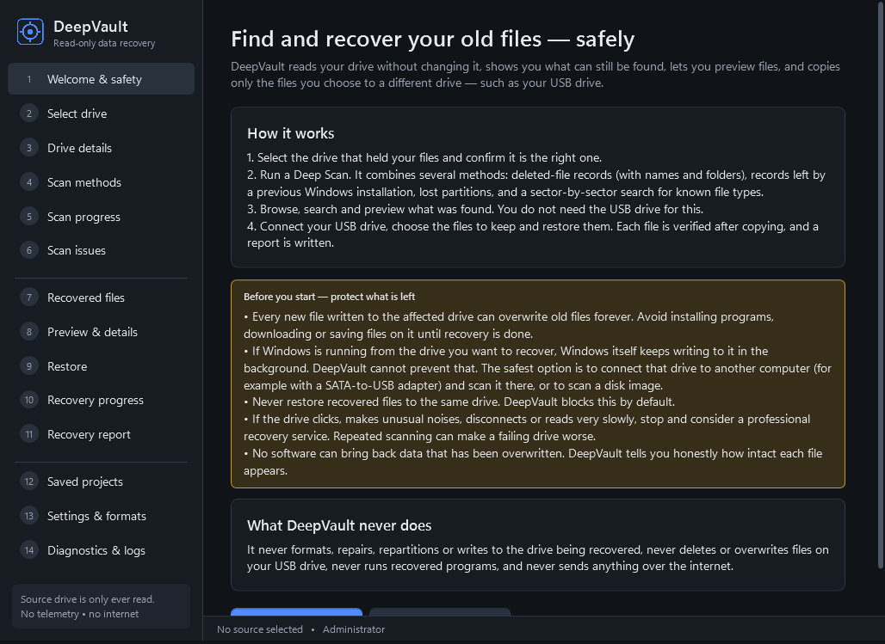
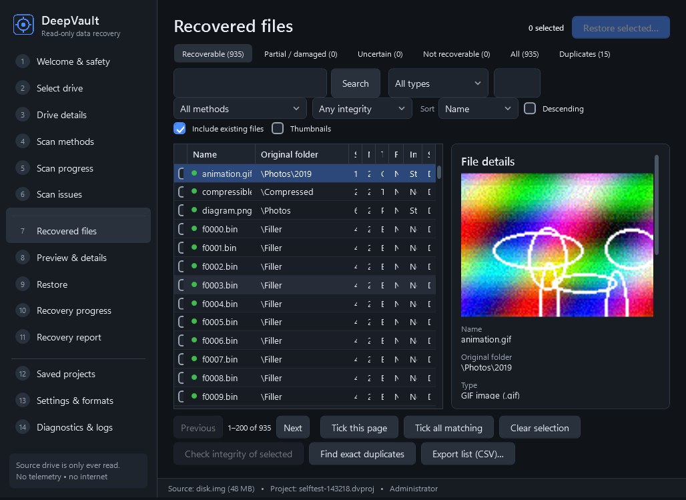
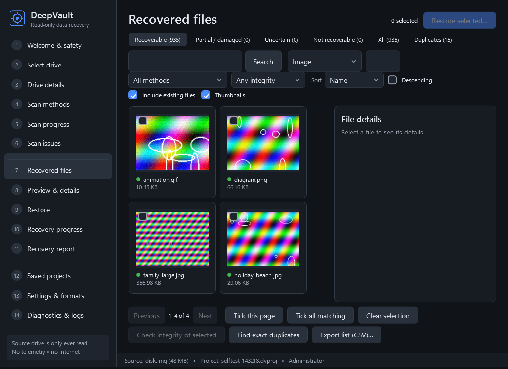
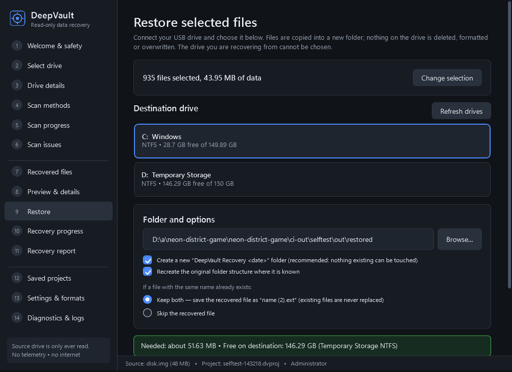

# DeepVault 1.0 — read-only data recovery for Windows

DeepVault finds files that are still physically present on a drive after accidental deletion,
a quick format / Windows reinstallation, lost partitions or file-system damage. It lets you
preview what was found and copies only the files you choose to a **different** drive (for
example a USB drive), verifying every copy.

It never writes to, repairs, formats or repartitions the drive being recovered, never deletes or
overwrites anything on the destination, has no telemetry and never connects to the internet.

> No software can recover data that has been overwritten. DeepVault reports honestly how intact
> each candidate appears; a file being *found* does not mean it can be *fully* recovered.

## What is in this release

| Component | Description |
|---|---|
| `DeepVault.exe` | WPF desktop application (dark theme, 14 pages, no command line needed) |
| `deepvault-cli.exe` | Command-line tool with the same engines (scripting, advanced users) |
| `src/DeepVault.Core` | Platform-independent recovery engines, catalogue, restore, imaging, previews |
| `src/DeepVault.Platform.Windows` | The only code that touches raw disks: `GENERIC_READ` + query-only IOCTLs |
| `tests/` | 25 automated tests on disposable disk images built with real file-system drivers |

## Recovery engines (all operational)

| Engine | Method | Recovers names/folders | Tested against |
|---|---|---|---|
| A — NTFS MFT analysis | every MFT record incl. deleted files/folders; fragmented, resident, sparse, LZNT1-compressed, attribute-list files; overwrite estimate from `$Bitmap` | yes | ntfs-3g deletions (Linux); Windows-NTFS deletions in CI |
| A — FAT12/16/32 | directory walk incl. deleted entries & deleted folders, LFN reassembly, format-validated reconstruction | yes (8.3-only names lose 1st char) | mtools deletions |
| A — exFAT | deleted entry sets, NoFatChain exact layouts | yes | exfat-fuse deletions |
| B — Signature carving | 40 formats with structure validators (CRC-checked where the format has checksums) | no | raw layout with damaged/fragmented/truncated files |
| C — Partitions & lost volumes | MBR/EBR, GPT (both copies, CRC), boot-sector & backup-boot-sector search | n/a | wiped MBR+GPT+NTFS boot sector |
| D/E — Previous file-system records | orphan MFT records outside the current MFT (e.g. after a reinstall), old-volume geometry inference, format validation | yes | quick-reformatted + reused NTFS volume |

The **Deep Scan — All Applicable Methods** runs them in one sequential pass over the disk,
correlates and de-duplicates results, records every unreadable/skipped region and is
checkpointed so it can be stopped and resumed.

## Screenshots (captured automatically on Windows by the GUI self-test)

| | |
|---|---|
|  |  |
|  |  |

## Quick start

1. Read `docs/SAFETY.md` (5 minutes). **Most important:** stop using the affected drive.
2. Unzip `DeepVault-1.0.0-win-x64` anywhere (preferably onto the USB drive, not the drive you
   are recovering) and run `DeepVault.exe`.
3. Practise first on a disk image: `test-images/*.img.gz` in the package (unzip with 7-Zip) →
   *Select drive → Open a disk image instead…*. See `docs/USER_GUIDE.txt`, section 3.
4. For the real drive, click *Restart as administrator*, select the drive, confirm its model,
   size and serial number, run the Deep Scan, browse/preview, then restore to the USB drive.

## Documentation

| File | Content |
|---|---|
| `docs/USER_GUIDE.txt` | Plain-text Windows setup and usage guide, choosing the correct source drive, restoring to USB |
| `docs/SAFETY.md` | Safety instructions for scanning your original HDD; Mode 1 (live) vs Mode 2 (offline/image) |
| `docs/ENGINES.md` | Recovery-engine documentation and registry |
| `docs/FORMATS.md` | Supported file formats and how each is validated |
| `docs/SIGNATURES.md` | Adding your own signatures (JSON) |
| `docs/ARCHITECTURE.md` | Engineering plan, components, data model |
| `docs/BUILD.md` | Build and packaging instructions |
| `docs/TROUBLESHOOTING.md` | Common problems |
| `docs/TEST_PLAN.md` | Automated tests and the repeatable manual test plan |
| `docs/TEST_RESULTS.md` | Tests actually executed and their recorded outcomes |
| `docs/KNOWN_LIMITATIONS.md` | What is not supported or not verified |
| `docs/THIRD_PARTY.md` | Dependency and licence inventory; evaluation of external engines |

## Licence

Copyright (c) 2026. All rights reserved (see `LICENSE.txt`). Third-party components are listed
with their licences in `docs/THIRD_PARTY.md`; all are permissive (MIT / Apache-2.0 / public domain).
